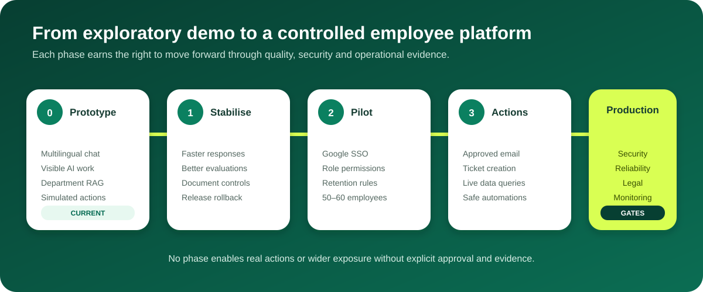

# Roadmap

## Current prototype — implemented

- Multilingual chat and browser speech-to-text.
- Department-aware onboarding and owner approval.
- Separate department knowledge databases.
- Hybrid keyword and semantic retrieval with citations.
- Multi-stage, visible AI work progress.
- Conversation context and audit events.
- Confirmation-gated simulated actions.
- Regression tests for core routing, grounding, language and orchestration behavior.
- Persistent conversation history with rename and deletion.
- Editable employee context memory.
- Answer feedback, evidence-quality labels and an owner quality dashboard.
- Knowledge source freshness, chunk counts and semantic-index status.
- Live orchestration cancellation and retry.
- Versioned golden-question quality benchmark and scoring runner.
- Owner-only RAG service status plus guarded start, stop, restart and SSH recovery scripts.

## Phase 1 — stabilize the demonstration

- Add a versioned release manifest and one-command rollback on top of the current project-local deployment backups.
- Improve CPU response latency and introduce partial answer streaming.
- Add document disable/delete controls, ownership and background re-index jobs.
- Expand browser end-to-end tests for voice, language and long-task progress.
- Add structured error messages and model timeouts/failover.
- Expand the benchmark to 30-50 approved cases per department with native-speaker review.

## Phase 2 — controlled internal pilot

- Google Workspace SSO/2FA and employee lifecycle integration.
- Formal department and role permission matrix.
- Data classification, retention and deletion policies.
- Action connector framework with approval, idempotency and audit contracts.
- Read-only integrations for selected live systems.
- Usage, quality, latency and safety dashboards.
- Pilot feedback and evaluation set across all participating departments/languages.

## Phase 3 — approved actions

- Email drafting and sending through an approved account.
- Ticket creation and status lookup.
- Approved live-data queries.
- Automation execution with failure handling and escalation.
- Image generation through an approved self-hosted model.

## Production gates

- Security and privacy review.
- Legal/compliance approval.
- Load and reliability testing.
- Disaster recovery and database backup plan.
- Monitoring and incident ownership.
- Model evaluation, prompt-injection testing and human-review rules.
- Written approval for public/network exposure.
