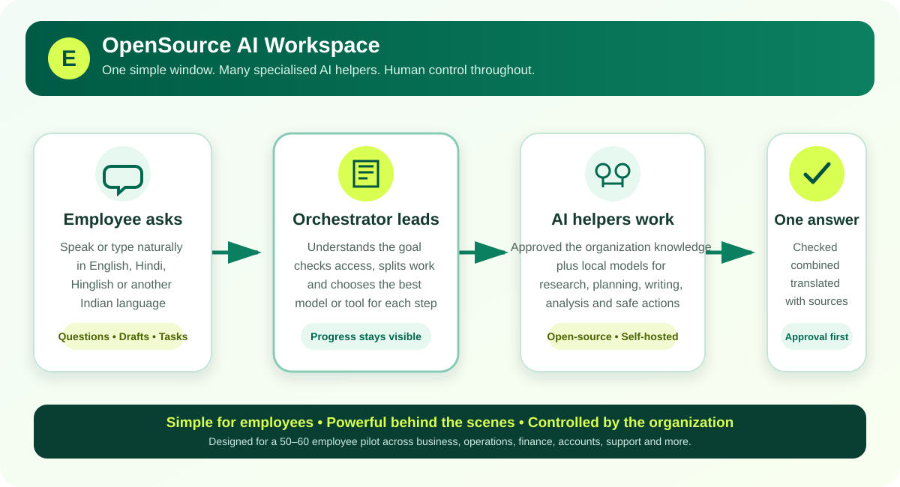
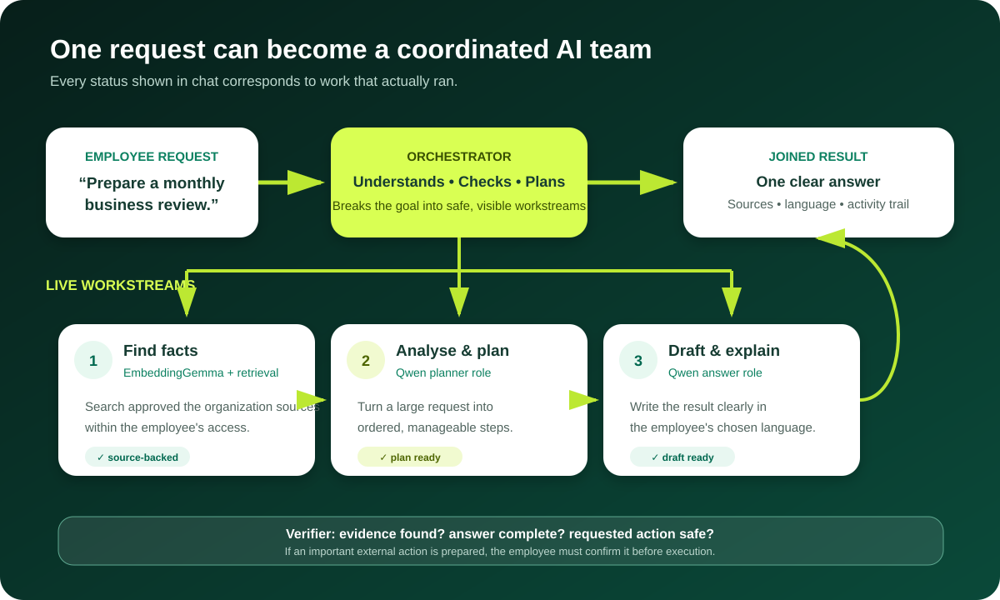
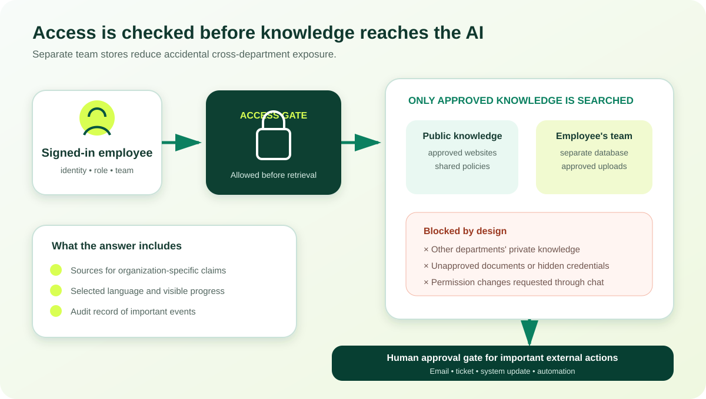

# the configured assistant Prototype Architecture

This document describes the prototype in practical terms for product, engineering, security, and operations teams.

## One-sentence view

An employee asks for help in a familiar language; the orchestrator understands the request, checks the employee's access, finds approved the organization knowledge, assigns suitable AI models or tools, shows progress, verifies the result, and returns one joined answer.

## Request flow

1. The employee signs in and chooses a language and department.
2. The chat accepts typed text or browser speech-to-text.
3. The orchestrator identifies the request type, language, risk, and required information.
4. The access layer limits knowledge retrieval to public content and the employee's permitted team content.
5. The planner breaks a larger request into visible steps.
6. The model router assigns each step to the configured local model or a tool.
7. The executor runs those steps and streams their status into the same chat window.
8. The verifier checks the combined response for evidence, completeness, and unsafe action requests.
9. The assistant answers in the selected language and displays sources when knowledge was used.
10. Important events are recorded in the audit trail.

## Main components

### Browser interface

- Employee chat, onboarding, language selector, voice input, sources, and orchestration progress.
- Admin views for users, team access, documents, audit events, quality and RAG service operations.
- Current files: `app/static/index.html`, `app/static/app.js`, `app/static/enhancements.js`, `app/static/styles.css`, and `app/static/enhancements.css`.

### FastAPI application

- Serves the interface and JSON/WebSocket APIs.
- Maintains the demo session and permission checks.
- Coordinates retrieval, planning, model calls, actions, and audit events.
- Entry point: `app/main.py`.

### Orchestrator

- `app/orchestrator.py` handles intent, planning, routing, execution, verification, and final response assembly.
- WebSocket progress is sent through `/api/chat/stream` so employees can see work as it happens.
- A normal request may use one model; a complex request may be split across several model roles.

### Knowledge layer

- `app/knowledge.py` retrieves relevant passages from the organization website content and uploaded documents.
- Retrieval is hybrid: semantic similarity plus keyword matching.
- Every indexed passage is tagged with its team so access can be enforced before it enters a prompt.
- Website ingestion is handled by `scripts/ingest_websites.py`.

### Model layer

Models are served locally through Ollama. The defaults are:

- Primary answer model: `qwen3:4b`
- Faster fallback/specialist: `qwen3:1.7b`
- Lightweight planning steps: `qwen3:0.6b`
- Embeddings for retrieval: `embeddinggemma`

The model names are configuration, not hard-coded product promises. They can be changed in `.env` after testing quality, speed, licensing, and hardware fit.

### Data layer

- `data/control.db`: users, editable profiles, conversations, messages, answer feedback, actions, and audit events.
- `data/knowledge/public/knowledge.db`: public knowledge.
- `data/knowledge/<team>/knowledge.db`: isolated knowledge index for each team.
- `data/uploads/`: source files uploaded for ingestion.

SQLite is appropriate for this controlled 50-60 user prototype. Production scale and high availability should trigger a review of PostgreSQL, a dedicated vector store, durable queues, and object storage.

## API surface

The current application exposes:

- Session and onboarding: `/api/session`, `/api/login/demo`, `/api/logout`, `/api/onboarding`
- Preferences and access: `/api/preferences/language`, `/api/teams`
- Assistant: `/api/chat`, `/api/chat/stream`
- Employee workspace: `/api/profile`, `/api/conversations`, conversation detail/rename/delete, and message feedback
- Knowledge: `/api/documents`, `/api/documents/upload`
- Administration: `/api/admin/users`, approval endpoint, `/api/admin/audit`, `/api/admin/dashboard`
- RAG operations: `GET /api/admin/system` and `POST /api/admin/system/{action}`
- Actions: `/api/actions`, `/api/actions/{action_id}/confirm`
- Operations: `/api/health`

## Access and safety boundaries

- The current login is a prototype flow, not production 2FA.
- The intended production identity flow is an organization-domain account, password, and email OTP or enterprise SSO.
- Team access is enforced before retrieval, not just hidden in the interface.
- External actions are simulated in the prototype and use explicit confirmation gates.
- Email, ticketing, and live-system connectors must add least-privilege service accounts, allowlists, idempotency, and audit records before real execution is enabled.
- The server binds to localhost by default and should be exposed only through an approved reverse proxy or SSH tunnel.
- WebSocket cancellation stops the application task and updates the visible execution state; retrieval is moved off the event loop so the cancellation message remains responsive.
- RAG service mutations require an owner session, a separate service-control key and an exact per-action confirmation phrase. The API schedules only fixed project scripts; those scripts validate command and working-directory ownership before signalling a PID.

## Deployment shape

The RAG host runs Ollama and the FastAPI application on private loopback ports. Project-local scripts manage only those two processes and keep PID and log files inside the project. Nginx can become the controlled entry point when authentication, TLS, request limits, logging, and security review are ready. The Windows workspace is the editable source; deployment to the RAG copy is always deliberate and excludes `.env`, runtime data, model blobs and logs.
